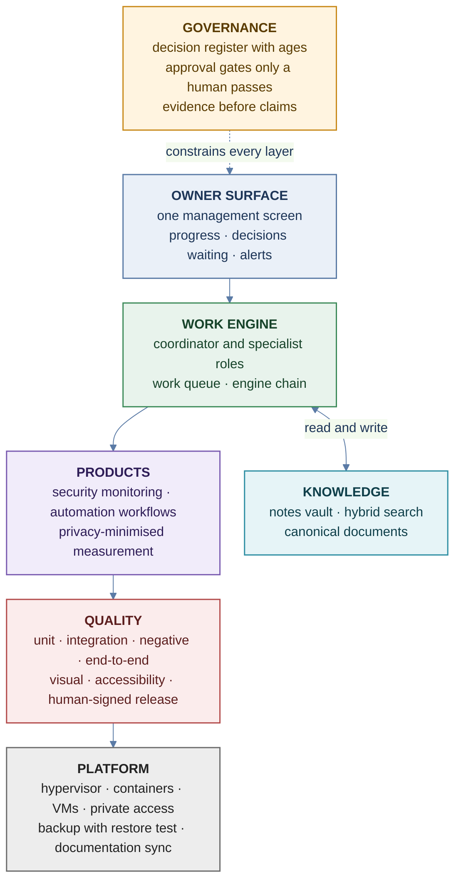

# enterprise-infrastructure-lab

> Infrastructure patterns, quality gates and an AI-agent operating model for a small engineering lab, documented the way they would be run in production.

## Run a restore drill

A backup is only real once it has been restored and compared. This drill needs no cloud account and no admin rights; it uses a temporary directory and the Python standard library only.

```bash
python tools/restore_drill.py        # or: make restore-drill
```

It creates sample data, writes a SHA-256 manifest, backs up to `tar.gz`, deletes the source (simulated loss), restores to a separate path and compares hashes and file count. Exit code 0 means PASS, 1 means FAIL. `--tamper` corrupts the backup first, so you can see a FAIL.

Real output (Windows 11 Pro 10.0.26300, Python 3.12.10, run on 2026-11-17):

```text
[1/5] sample data: 4 files
[2/5] backup written: backup.tar.gz (1957 bytes), manifest has 4 SHA-256 entries
[3/5] simulated loss: source directory deleted (exists=False)
[4/5] restored to a separate path: 4 files
[5/5] verification: all hashes match, file count matches
RESULT: PASS (0.05s)
```

Tests: `python -m unittest discover -s tests` ran 8 tests, OK, on the same machine (`make test` runs the same tests plus the shell restore test, but `make` is not installed on that machine, so the Makefile targets themselves were not run there). The CI workflow runs the same unittest command on ubuntu-latest. The drill covers file-level backup and restore of a small sample only; it does not test your real backup tool, storage or restore time.

### Audit-ready evidence: measured RTO/RPO and a sealed record

PASS/FAIL alone is not what an auditor asks for. The drill can also measure recovery objectives against a policy file and write a sealed evidence record:

```bash
python tools/restore_drill.py --data-class critical --backup-age-minutes 10 --evidence evidence.json
python tools/verify_evidence.py evidence.json      # exit 0 = valid, 1 = invalid, 2 = unreadable
```

- **Targets** come from [examples/backup/recovery-objectives.json](examples/backup/recovery-objectives.json) (`rto_minutes`, `rpo_minutes` per data class; the values are illustrative placeholders, not recommendations). An unknown class or an unreadable file is an error (exit 2), not a silent pass.
- **Measured RTO** is the time from the simulated loss (source deleted) to a completed, verified restore. For this four-file sample it is a few milliseconds, which says nothing about your real systems.
- **RPO is simulated, not measured.** `--backup-age-minutes` sets the age of the backup at the moment of loss; the record labels it as simulated. A real RPO needs the timestamps of your real backup job.
- The record names the machine and the OS user unless you pass `--host-label` and `--operator`. Check both fields before you share a record. Records named `evidence*.json` and `restore-evidence*.json` are git-ignored by default.
- The run **fails (exit 1)** if the restore is not intact, if the RTO is exceeded, or if the RPO is exceeded. The evidence record is still written, with `result: FAIL`.
- **Integrity seal.** The record carries a SHA-256 over its canonical JSON (sorted keys, compact separators). With `--hmac-env VAR` the seal is HMAC-SHA256 using the key held in environment variable `VAR`. The key must never be committed, passed on a command line or stored next to the evidence; the record stores only the variable's name. A plain SHA-256 seal detects accidental change but anyone can recompute it after editing, so for anything an auditor will rely on use the HMAC seal and keep the key with the control owner. Even then the seal proves the record was not changed after sealing; it does not prove the drill ran on real systems.

Real output, same machine as above (Windows 11 Pro 10.0.26300, Python 3.12.10, 2026-11-17). `--operator` and `--host-label` were set to generic values so the machine name and user name are not published:

```text
$ python tools/restore_drill.py --data-class critical --backup-age-minutes 10 --evidence evidence.json --operator example-operator --host-label lab-workstation
[1/5] sample data: 4 files
[2/5] backup written: backup.tar.gz (1938 bytes), manifest has 4 SHA-256 entries
[3/5] simulated loss: source directory deleted (exists=False)
[4/5] restored to a separate path: 4 files
[5/5] verification: all hashes match, file count matches
      RTO: measured 0.0003 min vs target 60 min -> met
      RPO: simulated backup age 10.0 min vs target 15 min -> met
RESULT: PASS (0.14s)
evidence written: evidence.json (seal: sha256)
$ python tools/verify_evidence.py evidence.json
seal: sha256 OK
record: schema restore-evidence/1, result PASS, files 4, objectives RTO met=True RPO met=True
VERDICT: VALID
```

A failing case: the backup is 45 minutes old at the time of loss, the `critical` target is 15 minutes. The restore itself is intact, but the run exits 1:

```text
$ python tools/restore_drill.py --data-class critical --backup-age-minutes 45 --evidence fail.json --operator example-operator --host-label lab-workstation
...
      RTO: measured 0.0004 min vs target 60 min -> met
      RPO: simulated backup age 45.0 min vs target 15 min -> EXCEEDED
RESULT: FAIL (0.14s)
evidence written: fail.json (seal: sha256)
$ echo $?
1
$ python tools/verify_evidence.py fail.json        # an honest FAIL record is a valid record
seal: sha256 OK
record: schema restore-evidence/1, result FAIL, files 4, objectives RTO met=True RPO met=False
VERDICT: VALID
```

Editing the failed record to say `PASS` is detected:

```text
$ sed 's/"result": "FAIL"/"result": "PASS"/' fail.json > edited.json
$ python tools/verify_evidence.py edited.json
FAIL: seal mismatch (sha256): the record changed after sealing, or the wrong key was used
FAIL: result 'PASS' is inconsistent with the verification and objectives
VERDICT: INVALID
```

An HMAC-sealed record (key from the environment, here a throwaway demo value) verifies with the right key and is rejected with a wrong one (outputs from the same session):

```text
$ python tools/restore_drill.py --data-class important --backup-age-minutes 30 --evidence hmac.json --hmac-env RESTORE_EVIDENCE_HMAC_KEY
evidence written: hmac.json (seal: hmac-sha256)
$ python tools/verify_evidence.py hmac.json                                   # right key -> VERDICT: VALID, exit 0
$ RESTORE_EVIDENCE_HMAC_KEY=wrong python tools/verify_evidence.py hmac.json   # exit 1
FAIL: seal mismatch (hmac-sha256): the record changed after sealing, or the wrong key was used
VERDICT: INVALID
```

What the record contains and how it maps to what an auditor typically asks for is in [docs/backup-recovery.md](docs/backup-recovery.md#evidence-for-an-auditor). Tests: `python -m unittest discover -s tests` now runs 34 tests (was 8).

Status of the examples: only `examples/backup/restore-test.sh` and this drill are executed by tests. The Terraform example in `examples/terraform/main.tf` is **not applied or validated** (see [examples/README.md](examples/README.md)).

## What it does and what it makes easier

- Turns 'how should this be run?' into short, reviewable documents: principles, a reference design, and how to prove it works.
- Makes reviews, audits and hand-overs easier, because every topic states its decisions, trade-offs and checks in one place.
- Shows how the layers of a modern stack fit together: platform, knowledge, agents, products, quality and governance.

## Architecture at a glance



The layers, from governance down to the platform. Topology, data flows and the host are drawn in docs/topology.md.

## Documents

| Area | Document | Status |
|---|---|---|
| Whole stack, hardware to services | [docs/end-to-end-architecture.md](docs/end-to-end-architecture.md) | in use |
| Topology diagrams and layers (host, containers, VMs, app and service layers) | [docs/topology.md](docs/topology.md) | in use |
| Layered architecture and decisions | [docs/architecture.md](docs/architecture.md) | in use |
| Administrative access model | [docs/access-model.md](docs/access-model.md) | in use |
| Documentation as code | [docs/documentation-sync.md](docs/documentation-sync.md) | in use |
| Network segmentation and firewalling | [docs/network-segmentation.md](docs/network-segmentation.md) | reference pattern |
| Backup and recovery | [docs/backup-recovery.md](docs/backup-recovery.md) | reference pattern |
| Quality engineering (QA, E2E, release gates) | [docs/quality-engineering.md](docs/quality-engineering.md) | in use |
| Runnable examples: restore test, docs sync, access, Ansible, Terraform | examples/ | restore test runs and is tested; others checked, see examples/README.md |
| Product measurement with privacy by design | [docs/measurement-and-privacy.md](docs/measurement-and-privacy.md) | reference pattern; implemented and tested, production rollout pending |
| Agent engine design | [docs/agent-engine.md](docs/agent-engine.md) | in use |
| Personal knowledge system | [docs/second-brain-knowledge-system.md](docs/second-brain-knowledge-system.md) | in use |
| Architecture decision records | [docs/adr/](docs/adr/) | in use |

Status: 'in use' means practiced in the lab. 'Reference pattern' means a design written for production-style use; where code exists, the status line says how far it has been rolled out.

## Principles

1. One source of truth, linked rather than copied.
2. Deterministic where it matters; models where judgement helps.
3. Evidence before claims; humans for gates.
4. Least privilege for every key, account and agent.
5. Narrow interfaces between layers, so each can be replaced.

## How to read this repository

Start with the end-to-end architecture, then read the topic that matches your question. Each document is short on purpose and ends with how to check it works.

## Sanitization

All host names, addresses and identifiers are removed or replaced. Example addresses use the documentation ranges in RFC 5737 (192.0.2.0/24, 198.51.100.0/24, 203.0.113.0/24).

## License

Documents: [CC BY 4.0](LICENSE). **Attribution is required**, see [ATTRIBUTION.md](ATTRIBUTION.md) for the wording.
Software and examples (`examples/`, `scripts/`, `tests/`, `Makefile`): [MIT](LICENSE-CODE).
